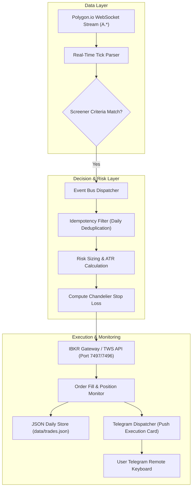
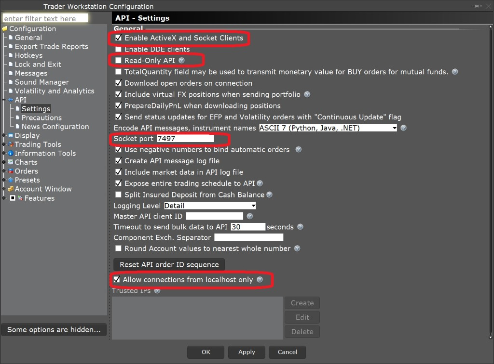

# 📊 Real-Time NASDAQ Screener & ATR Chandelier Execution Bot

[](https://python.org)
[](https://polygon.io)
[](https://interactivebrokers.com)
[](https://core.telegram.org/bots)
[](https://opensource.org/licenses/MIT)

> An institutional-grade intraday momentum screener and automated execution bot built for **NASDAQ equities**. Powered by real-time tick streaming via **Polygon.io WebSockets**, automated **Interactive Brokers (IBKR)** order execution, dynamic **Average True Range (ATR) Chandelier trailing stops**, and an interactive **Telegram remote command & control terminal**.

---

### 💼 Need Custom Broker Screener Bots, Quant Execution Engines, or Telegram Terminals?
I build institutional trading software, low-latency WebSocket market screeners, and automated risk systems.
* 💬 **Telegram:** [@JanzebBlockdev](https://t.me/JanzebBlockdev)
* 💼 **Fiverr Profile:** [Verified Quantitative Developer (Fiverr)](https://www.fiverr.com/jahanzaib313110)
* 📧 **Email:** `jahanzaibchanna70@gmail.com`

---

## 📑 Table of Contents
1. [Key Architectural Highlights](#-key-architectural-highlights)
2. [End-to-End System Architecture](#-end-to-end-system-architecture)
3. [Telegram Command & Control Interface](#-telegram-command--control-interface)
4. [Screener Filtering Logic](#-screener-filtering-logic)
5. [ATR Chandelier Trailing Risk Management](#-atr-chandelier-trailing-risk-management)
6. [Prerequisites & Environment Configuration](#-prerequisites--environment-configuration)
7. [Installation & Quickstart](#-installation--quickstart)
8. [Explore Other Quantitative Projects](#-explore-other-quantitative-projects)
9. [Disclaimer](#-disclaimer)

---

## 🚀 Key Architectural Highlights

* **Ultra Low-Latency Tick Processing:** High-frequency Polygon.io WebSocket streaming captures second-by-second volume surges and price breakouts across thousands of tickers.
* **Smart Auto-Entry System:** Detects initial filter breaches and executes limit/market orders with idempotent daily deduplication guards.
* **Chandelier Trailing Stops:** Computes ATR-based dynamic stops that ratchet upwards with profitable price advances and never decay downward.
* **EOD Liquidation Protection:** Enforces automated risk closure $N$ minutes before market close (15:50 ET) to eliminate overnight gap risk.
* **Interactive Telegram Command Center:** Full remote terminal allowing real-time portfolio audits, live/dry-run mode switching, and emergency manual kill switches.

---

## 🏛️ End-to-End System Architecture



---

## 📱 Telegram Command & Control Interface

Manage and monitor your live trading infrastructure from any mobile or desktop Telegram client:

```
┌────────────────────────────────────────────────────────┐
│  🤖 NASDAQ ATR Screener Terminal (LIVE SESSION)        │
│  Status: ACTIVE | Port: 7497 | Mode: 🟢 LIVE           │
├──────────────────────────┬─────────────────────────────┤
│  🧾 Portfolio Status     │  📈 Open Positions          │
├──────────────────────────┼─────────────────────────────┤
│  📤 Closed Trades        │  🌀 Stocks List (Filtered)  │
├──────────────────────────┼─────────────────────────────┤
│  🔍 Active Stop Status   │  📄 Operations Log          │
├──────────────────────────┼─────────────────────────────┤
│  🔄 Force Scan Run       │  📊 Daily Performance P&L   │
├──────────────────────────┼─────────────────────────────┤
│  🟢 Toggle Live / Dry    │  ❌ Emergency Close All     │
└──────────────────────────┴─────────────────────────────┘
```

---

## 🔍 Screener Filtering Logic

The scanner continuously evaluates inbound quotes against high-probability breakout metrics:
* **Price Filter:** \$0.50 – \$15.00 USD (Micro/Small-cap explosive momentum).
* **Relative Daily Change:** Momentum expansion thresholds (configurable).
* **Surge Volume Filter:** Minimum liquidity requirements (e.g., 2,000,000+ shares).
* **Market Capitalization:** Targets agile equities with high price velocity.

---

## 🛡️ ATR Chandelier Trailing Risk Management

```math
\text{Initial Stop} = \text{Entry Price} - (\text{ATR}_{14} \times \text{Multiplier})
```
```math
\text{Chandelier High} = \max(\text{High}_{t-n}, \dots, \text{High}_t)
```
```math
\text{Ratchet Stop} = \max(\text{Previous Stop}, \text{Chandelier High} - (\text{ATR} \times \text{Multiplier}))
```
* **Loss Containment:** Trailing stops update on every closed interval bar.
* **Zero Retracement:** The stop price strictly ratchets higher, locking in unrealized gains automatically.

---

## ⚙️ Prerequisites & Environment Configuration

1. **Python 3.11+** installed.
2. Active **Polygon.io API Key** with stock WebSocket entitlements.
3. **Interactive Brokers TWS or IB Gateway** running with Socket API enabled on port `7497` (Paper) or `7496` (Live).
4. **Telegram Bot Token** from [@BotFather](https://t.me/BotFather).

<p align="center">
  
</p>

### Environment File (`.env`)
Create a `.env` file in the root directory:

```env
# Polygon.io Market Data
POLYGON_API_KEY=your_polygon_api_key_here
POLYGON_WS_URL=wss://socket.polygon.io/stocks
POLYGON_REST_URL=https://api.polygon.io
POLYGON_SUBSCRIBE_CHANNEL=A.*

# Interactive Brokers Connection
IB_HOST=127.0.0.1
IB_PORT=7497
IB_CLIENT_ID=7

# Telegram Remote Administration
TELEGRAM_BOT_TOKEN=your_telegram_bot_token_here
TELEGRAM_CHAT_ID=your_chat_id_here

# Strategy Parameters
ATR_TIMEFRAME=5m
ATR_PERIOD=14
ATR_MULTIPLIER=2.0
DRY_RUN=false
TIMEZONE=US/Eastern
```

---

## 🛠️ Installation & Quickstart

1. **Clone the repository:**
   ```bash
   git clone https://github.com/jahanzaib-codes/RealTime-ATR-Screener-Trader.git
   cd RealTime-ATR-Screener-Trader
   ```

2. **Setup virtual environment:**
   ```bash
   python -m venv .venv
   source .venv/bin/activate  # Windows: .venv\Scripts\activate
   pip install -r requirements.txt
   ```

3. **Launch the Engine:**
   ```bash
   python -m main
   ```
   *Upon launch, the bot connects to Polygon.io, validates IBKR Gateway status, and delivers an initialization greeting card to your private Telegram chat.*

---

## ⭐ Explore Other Quantitative Projects

* 🧠 **[Interactive Brokers AI 0DTE Options Bot & GUI](https://github.com/jahanzaib-codes/ibkr-ai-trading-bot-gui)** — ML-driven options execution terminal with XGBoost and Tkinter.
* 📉 **[IBKR Automated Trailing Stop Orders](https://github.com/jahanzaib-codes/ibkr-trailing-orders)** — CSV batch trailing stop limit order dispatcher with loss prevention.
* ⚡ **[Solana Pump.fun 0-Block Sniper Bot](https://github.com/jahanzaib-codes/solana-pumpfun-sniper-bot)** — Rust/Node.js low-latency meme coin sniper with Jito MEV bundles.
* 🛡️ **[PropFirm MT5 Risk Guardian EA](https://github.com/jahanzaib-codes/propfirm-mt5-risk-guardian)** — Institutional MQL5 risk manager enforcing equity drawdowns.

---

## ⚠️ Disclaimer

*This trading software is engineered for educational, algorithmic research, and demonstration purposes. Live trading involves substantial risk of capital loss. Verify all strategies extensively in paper trading mode before live capital deployment.*

---
*Maintained by **Jahanzaib** ([@jahanzaib-codes](https://github.com/jahanzaib-codes))*
